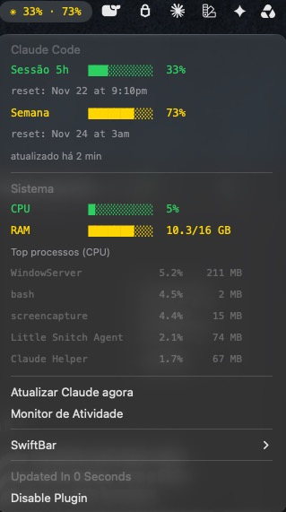

# Claude Usage for SwiftBar

A macOS menu bar widget that shows your **Claude Code** usage limits and basic system stats, built as a [SwiftBar](https://github.com/swiftbar/SwiftBar) plugin.



## What it shows

- **Menu bar:** `✳︎ 33% · 73%` (current 5-hour session · current week), colored by the higher value
- **Session (5h)** and **Week** usage bars, with reset times
- **CPU** and **RAM** usage
- Top 5 processes by CPU
- Colors: green below 50%, yellow from 50% to 80%, red above 80%

## Requirements

- macOS
- [Claude Code](https://docs.claude.com/en/docs/claude-code) installed and logged in (`claude` available in your terminal)
- [SwiftBar](https://github.com/swiftbar/SwiftBar)

## Install

```bash
brew install --cask swiftbar
mkdir -p ~/SwiftBar
curl -L -o ~/SwiftBar/claude-usage.10s.sh \
  https://raw.githubusercontent.com/<your-user>/claude-usage-swiftbar/main/claude-usage.10s.sh
chmod +x ~/SwiftBar/claude-usage.10s.sh
open -a SwiftBar
```

When SwiftBar asks for a plugin folder, choose `~/SwiftBar`.

To start it with your Mac, add SwiftBar in **System Settings › General › Login Items**.

## How it works

- Runs `claude -p "/usage"` in the background every 5 minutes and caches the result in `~/Library/Caches/claude-usage-swiftbar/`.
- System stats refresh every 10 seconds, so the menu bar never blocks.
- Use **Atualizar Claude agora** in the menu to force a refresh.
- If the output can't be parsed, the menu shows the raw text so you can see what changed.

## Configuration

- Claude refresh interval: edit `CLAUDE_INTERVAL` at the top of the script (seconds).
- System refresh interval: rename the file. `claude-usage.10s.sh` runs every 10 s, `claude-usage.30s.sh` every 30 s.

## Privacy

Runs locally. It sends nothing anywhere except what the `claude` CLI itself does to fetch your usage.

## Credits

Inspired by [widget-claude-status](https://github.com/MarleySMaia/widget-claude-status) by MarleySMaia, a floating usage widget for Windows.

## License

MIT
